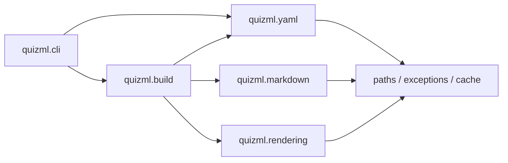

# Architecture

QuizML turns a YAML quiz into one or more configured outputs. It is structured
into **five independent, composable domain modules** (`paths`/`exceptions`/`cache`
primitives, `quizml.yaml`, `quizml.markdown`, `quizml.rendering`, `quizml.build`)
plus a thin `quizml.cli` adapter layer.

## Main components

| Component | Responsibility |
| --- | --- |
| `quizml.paths` | Finds configuration, schema, template, and supporting files across local, ancestor `_quizml/`, user, and package paths (`FileLocator`, `find_path`). |
| `quizml.yaml` | Loads and validates YAML quizzes (`load`, `loads` returning `QuizDocument`), resolves and samples `_include` directives, and provides pure YAML formatting (`format_yaml_text`), metadata pinning (`pin_yaml_text`), and duplicate detection (`compare_quiz_files`). |
| `quizml.markdown` | Normalizes Markdown options (`normalize_markdown_options`) and transcodes Markdown strings or documents into HTML, LaTeX, or Word OpenXML (`MarkdownTranscoder`, `transcode`, `transcode_text`, `transcode_many`). |
| `quizml.markdown.html_renderer` | Produces HTML math (PNG, SVG, MathML via `latex2mathml`, or passthrough) and embeds or references generated images. |
| `quizml.markdown.latex_renderer` | Prepares Markdown content and images for LaTeX output. |
| `quizml.markdown.docx` | Converts Markdown ASTs into Microsoft Word OpenXML (`<w:p>`, `<w:tbl>`, and OMML `<m:oMath>`). |
| `quizml.rendering` | Renders Jinja2 text templates (`render_template`), Word templates (`render_docx` via `docxtpl`), and IMS QTI 1.2 / 2.1 ZIP packages (`render_qti`) through a unified `render()` dispatcher. |
| `quizml.build` | Loads `quizml.cfg` (`load_config`), expands target aliases and topological dependencies (`dag.py`, `resolve_targets`), discovers cleanup artifacts (`get_cleanup_candidates`), and runs headless builds (`compile_quiz` returning `BuildResult`). |
| `quizml.cli` | Thin terminal adapter defining `argparse` commands, `rich` tables/errors, and `watchdog` + `LiveReloadServer` watch mode. |

## Data flow

1. `quizml.build.load_config` loads `quizml.cfg` (or `_config` from the quiz
   header) and `resolve_targets` selects targets (`--target`, header `_targets`,
   or `default_targets`). A target can be selected by name or through an alias;
   its dependencies are included and ordered topologically before it.
2. `quizml.yaml.load` reads the quiz's optional header and question list,
   expands document-relative includes (supporting `select` by question `id` or
   1-based index), and validates and coerces the resulting data against the
   configured schema (with any inline `schema_extensions` from `quizml.cfg`
   merged in). It returns a `QuizDocument` (`dict` subclass with `.header`,
   `.questions`, `.paths`, and `.schema` attributes).
3. For each target, `quizml.markdown` parses Markdown fields and converts them
   to the configured representation (`html`, `latex`, `docx`, or raw
   `markdown`). HTML targets can choose `png`, `svg`, `mathml`, or `passthrough`
   (client-side MathJax/KaTeX) equation output, with configurable DPI/scaling
   and optional custom HTML postprocessors; LaTeX targets receive
   LaTeX-formatted content; Word targets receive native OpenXML and OMML math.
4. `quizml.rendering.render` supplies the document, paths, target metadata, and
   any custom `context`/`vars` variables or `jinja_filters` to a Jinja2 text
   template, a Word (`docxtpl`) template, or a QTI 1.2 / 2.1 package directory.
   Text templates use `<| ... |>` for blocks, `<< ... >>` for expressions, and
   `<# ... #>` for comments. Undefined Jinja variables are errors.
5. Targets with `build_cmd` run external commands after their dependencies
   succeed. The bundled `build` alias selects the standard exports and PDF
   targets.

## Design notes

- YAML scalar values are initially preserved as strings, avoiding implicit
  conversions such as `NO` to `false`. Schema types control coercion across both
  `header` and `questions`; plain YAML `null` remains `None`.
- Markdown documents are parsed individually into isolated ASTs that are never
  mutated in-place during target rendering. QuizML's custom math and
  image-width tokens are registered only while parsing, to avoid leaking parser
  state to other users of Mistletoe.
- Templates, configs, schemas, and assets are found through `FileLocator` (in
  `quizml.paths`), which walks up parent directories from `base_dir` and `cwd`
  (stopping at `.git` repo boundaries) looking for `_quizml/` (and legacy
  `quizml-templates/`), then checks the resolved config's directory, the user
  config directory, and the packaged defaults. This allows `quizml init` to
  copy only `_quizml/quizml.cfg` by default while inheriting unmodified
  templates and schemas from the package.
- Both `LatexRunner` and `compile_cmd_target` prepend the quiz directory,
  configured `texinputs`, included figure directories, and `FileLocator` search
  directories to `TEXINPUTS` so custom `.cls`/`.sty` files, logos, and
  `\input{...}` assets inside `_quizml/` are found automatically by LaTeX
  compilers.
- Relative output paths, template lookups, and build commands are anchored to
  the input quiz's directory (or current working directory when reading from
  `stdin`). Target `out`, `build_cmd`, and `descr_cmd` strings support
  `${inputdir}`, `${inputbasename}`, `${inputstem}`, and sanitized scalar header
  variables (`${<header_key>}`).
- Equation and SVG-to-PDF conversions use QuizML's shared cache, keyed on
  content, preamble/converter settings, DPI/scale, and external tool versions.
  Run `quizml cache clear` to remove cached conversions.
- CLI subcommands keep `stdout` strictly reserved for data payloads (`fmt`,
  `sample`, `pin -o -`, `compile -o -`, and tab-separated `targets`/`diff`
  output when piped) and route all human diagnostics, banners, and errors to
  `stderr`.
