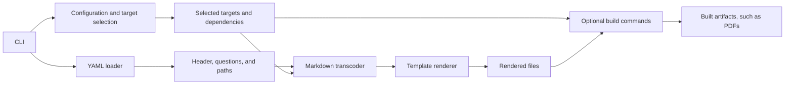

# Architecture

QuizML turns a YAML quiz into one or more configured outputs. The CLI loads the
configuration and quiz, prepares Markdown for each selected target, renders its
template, and optionally runs configured build commands.

## Main components

| Component | Responsibility |
| --- | --- |
| `quizml.cli.cli` | Defines the command line and dispatches subcommands. |
| `quizml.cli.config` | Loads `quizml.cfg`, expands target aliases and dependencies, and resolves target settings. |
| `quizml.cli.filelocator` | Finds configuration, schema, template, and supporting files across local, user, and package paths. |
| `quizml.loader` | Reads YAML documents, resolves question includes, validates data against a JSON Schema, and coerces values according to that schema. |
| `quizml.markdown.markdown` | Parses Markdown fields and converts them for the selected HTML or LaTeX target. |
| `quizml.markdown.html_renderer` | Produces HTML math and embeds or references generated equation images. |
| `quizml.markdown.latex_renderer` | Prepares Markdown content and images for LaTeX output. |
| `quizml.renderer` | Renders text templates with Jinja2 or Word templates with `docxtpl`. |
| `quizml.cli.compile` | Coordinates loading, target rendering, output writing, optional build commands, and watch mode. |

## Data flow

1. The CLI loads `quizml.cfg` and resolves selected targets. A target can be
   selected by name or through an alias; its dependencies are included and
   ordered before it.
2. The loader reads the quiz's optional header and question list, expands
   document-relative includes, and validates the resulting data against the
   configured schema. The loaded document has top-level `header`, `questions`,
   and `paths` values.
3. For each target, the Markdown transcoder parses Markdown fields and converts
   them to the configured representation. HTML targets can choose PNG, SVG, or
   MathML equation output; LaTeX targets receive LaTeX-formatted content.
4. The renderer supplies the document and paths to a Jinja or Word template.
   Text templates use `<| ... |>` for blocks, `<< ... >>` for expressions, and
   `<# ... #>` for comments. Undefined Jinja variables are errors.
5. Targets with `build_cmd` run external commands after their dependencies
   succeed. The bundled `build` alias selects the standard exports and PDF
   targets.

## Design notes

- YAML scalar values are initially preserved as strings, avoiding implicit
  conversions such as `NO` to `false`. Schema types control coercion; plain
  YAML `null` remains `None`.
- Markdown documents are parsed individually. QuizML's custom math and
  image-width tokens are registered only while parsing, to avoid leaking parser
  state to other users of Mistletoe.
- Templates and assets are found through `FileLocator`; relative output paths
  and build commands are based on the input quiz's directory.
- Equation and SVG-to-PDF conversions use QuizML's shared cache. Run
  `quizml cache clear` to remove cached conversions.
