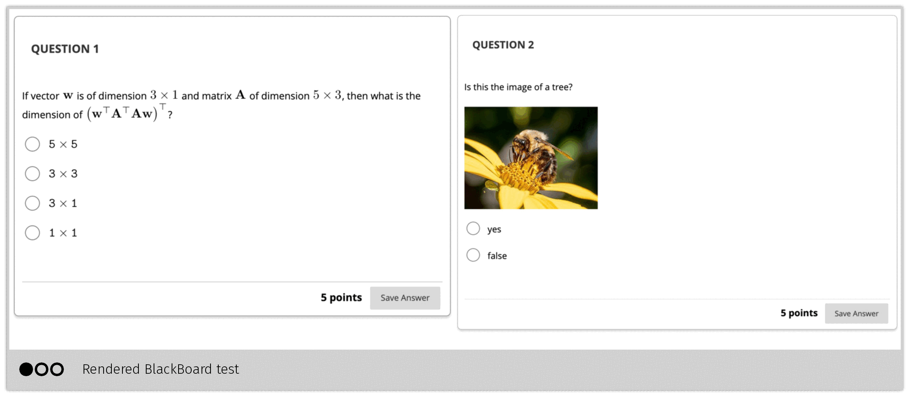

# QuizML

> QuizML converts quizzes written in YAML and Markdown into Blackboard,
> HTML, LaTeX, PDF, and Word outputs.

[](https://frcs.github.io/quizml)

Install QuizML with pip:

```bash
pip install quizml
```

Some output formats require a LaTeX installation and supporting tools such as
Ghostscript. TeX Live and MacTeX are common options. See the
[LaTeX setup guide](docs/config_latex.md) for details.

Questions are written in YAML with Markdown content.

Here is a minimal `quiz.yaml` example:

```yaml
- type: mc
  marks: 5
  question: |
    If vector ${\bf w}$ is of dimension $3 \times 1$ and
    matrix ${\bf A}$ of dimension $5 \times 3$,
    then what is the dimension of
    $\left({\bf w}^{\top}{\bf A}^{\top}{\bf A}{\bf w}\right)^{\top}$?
  choices:
    - o: $5\times 5$
    - o: $3\times 3$
    - o: $3\times 1$
    - x: $1\times 1$

- type: tf
  marks: 5
  question: |
    Is this the image of a tree?
    
    { width=30em }
    
  answer: false
```

Then generate the configured outputs, including a Blackboard import file,
LaTeX source, and an HTML preview:

```shell-session
$ quizml quiz1.yaml

  Q  Type  Marks  #  Exp  Question Statement
  ━━━━━━━━━━━━━━━━━━━━━━━━━━━━━━━━━━━━━━━━━━━━━━━━━━━━━━━━━━━━━━━━━━━━━━━━━━━━━━━
  1   mc     5.0  4  1.2  If vector ${\bf w}$ is of dimension $3 \times 1$ ...
  2   tf     5.0  2  2.5  Is this the image of a tree?

  Total: 10.0 (with random expected mark at 37.5%)

╭──────────────────────────────── Target Outputs ───────────────────────────────╮
│                                                                               │
│   Blackboard test  quiz1.txt                                                  │
│   html preview     quiz1.html                                                 │
│   latex            latexmk -xelatex -pvc quiz1.tex                            │
│   Latex solutions  latexmk -xelatex -pvc quiz1.solutions.tex                  │
│                                                                               │
╰───────────────────────────────────────────────────────────────────────────────╯
```

The rendered outputs look like this:




